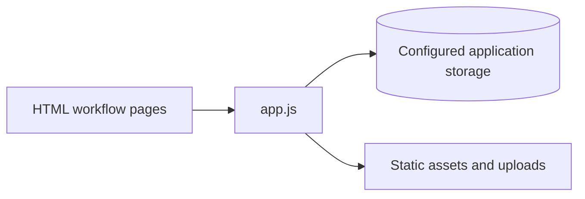

# Medical Kit

## Project overview

Medical Kit is a Node.js web prototype organized around patient and care workflows. Its HTML pages cover registration, records, prescriptions, emergency information, history, dashboards, and administrative management.

## Problem statement

The project explores how a single web application can collect and present patient-related information across separate user and administrative views.

## Application structure



## Implemented surface

- Registration and login pages.
- Patient dashboard and history views.
- Prescription and document forms.
- Emergency and log pages.
- Administrative management pages.

The exact persistence and route behavior is implemented in `app.js`; this README does not claim a production medical-record system.

## Setup

```bash
npm install
npm start
```

The package start script runs `node app.js`. Keep database URLs, session secrets, and uploaded private records outside source control.

## Project structure

- `app.js` — Node.js application entry point.
- `index.html`, `reg.html`, `register.html` — entry and registration flows.
- `dashboard.html`, `history.html`, `prescription.html`, `emergency.html` — user workflows.
- `manage.html`, `log.html` — management views.

## Security limitations

This is a prototype handling sensitive-data-shaped workflows. It requires a security review, strong authentication, authorization, encryption, audit logging, and privacy controls before real patient data is used.

## Status

Hackathon/prototype project.

## License

No license is currently declared.
